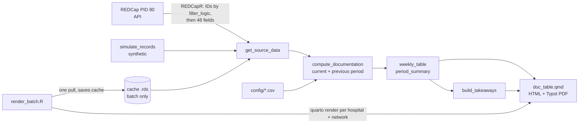

# Design: CIN-MNH Maternity Documentation Report

This document explains **how the code works and why it works that way**, so it can be maintained and extended safely. For installation and day-to-day use see [README.md](README.md).

---

## 1. Purpose and scope

The monthly *Maternity Newborn Health Report* shows large "Missing" proportions for many variables. This tool measures **documentation completeness** for the variables behind that report, week by week, per hospital and for the network. It also turns the results into **actions for sites**.

**In scope:** the % of mothers whose REDCap record documents each key variable; the trend within the period; the comparison with the previous period; a site comparison.
**Out of scope:** clinical indicator values (those are in the monthly report), the accuracy of entered values, newborn/NBU data, and risk categorisation, which is derived from about 45 inputs rather than being one variable.

**Users:** the CIN data team, who run it; hospital records and clinical teams, who receive it.

---

## 2. Architecture

| Module | Responsibility | Key functions |
|---|---|---|
| `R/redcap_logic.R` | Evaluate REDCap logic (branching, form display, filter) in R with REDCap's semantics | `eval_redcap_logic()`, `redcap_logic_to_r()`, `logic_fields()`, `redcap_datediff()` |
| `R/pipeline.R` | Configuration, API access, expected/documented computation, aggregation | `read_form_logic()`, `fields_needed()`, `period_filter_logic()`, `pull_records()`, `get_source_data()`, `prior_period()`, `compute_documentation()`, `weekly_table()`, `period_summary()`, `load_report_data()` |
| `R/takeaways.R` | Rule-based "Key takeaways for action" | `build_takeaways()`, `period_name()` |
| `R/synthetic.R` | Synthetic REDCap-shaped data obeying the dictionary, branching logic and form display logic | `simulate_records()` |
| `R/render_batch.R` | Batch orchestration: one pull, a report per hospital, the network report, the log | CLI script |
| `doc_table.qmd` | Presentation: callout, takeaways, weekly table, by-hospital table, notes | `cell()`, `md_table()`, `chip()` |

The design separates **computation** (`R/`) from **presentation** (`.qmd`) and **policy** (`config/`). Most changes touch only one of the three.

---

## 3. Data flow, step by step

1. **Period.** The period comes from `month` (or `start_date`/`end_date`). `prior_period()` derives the comparison window: the previous calendar month for whole-month reports, otherwise the same length immediately before.
2. **Fields.** `fields_needed()` starts from the report variables, the record ID, `hosp_id`, `admission_date` and `datetime_entry`. It then **recursively** adds every field referenced by their branching logic and by the form display logic of their forms, because expected-ness can't be evaluated without them. Today that's 48 fields, none of them identifiers.
3. **Pull** (two steps, `pull_records()`):
   1. Export only record IDs with `filter_logic = period_filter_logic(start, end, hospital)`, so REDCap selects the hospital and window on the server.
   2. Export the needed fields for those IDs (`batch_size = 500`).

   Selecting IDs first and then pulling by ID gives the same result whatever REDCap does with filter logic on repeating rows.
4. **Compute** (`compute_documentation()`), run once for the current period and once for the previous one. The previous period is used only by the takeaways.
   - Keep non-repeating rows only, since all report variables are on non-repeating forms.
   - Anchor = `admission_date`, else `datetime_entry`; then re-apply the period and hospital filter in R. This is the safety net behind the server filter, and the only filter for synthetic data.
   - For each report row and mother: `expected = expected_when ∧ ⋀(form display logic ∧ branching logic)` over the row's fields; `documented = ⋀ is_documented(field)`.
   - Output, a long table: `row, record_id, hosp, week, expected, documented, disabled`.
5. **Aggregate.** `weekly_table()` sums by row and week, then fills every row × week with zeros, so empty weeks show "–". `period_summary()` gives row totals, optionally by hospital.
6. **Takeaways.** `build_takeaways()` applies the rules in §7.
7. **Render.** `doc_table.qmd` formats cells as HTML `
`s or as raw Typst boxes inside markdown tables.

### Data contract: the object returned by `load_report_data()`

| Element | Content |
|---|---|
| `doc`, `prior_doc` | Long tables (step 4) for the current and previous periods |
| `table` | `row, week, n_expected, n_documented, pct` |
| `rv` | Report variables (+ `row`, `fields_list`) |
| `fdl` | `logic` (combined form display logic per form), `disabled` (form names) |
| `weeks`, `mothers_by_week`, `n_mothers`, `n_mothers_prior` | Denominators |
| `network`, `hospital`, `hosp_labels` | Mode and labels |
| `start`, `end`, `prior_start`, `prior_end`, `source`, `pulled_at`, `missing_codes` | Metadata |

---

## 4. Key design decisions

| # | Decision | Why | Alternatives rejected |
|---|---|---|---|
| D1 | **Denominator = mothers for whom REDCap would show the question** (form display logic ∧ branching) | Otherwise conditional fields look falsely incomplete. Example: *referral type* for non-referred mothers. | Counting all mothers for every variable |
| D2 | **Multiple display rules for one form combine with OR** | REDCap documents that a form listed in several conditions is enabled if *any* is true. Our form display logic export lists Labour Monitoring, Uterotonic Details and Newborn Discharge Summary twice. | AND, which would misclassify those forms |
| D3 | **A form whose rules are all constant-false (`1=2`) is "disabled"; its rows show "Form disabled", not 0%** | Chosen by the CIN team: a blocked form is a configuration issue, not a documentation failure by the site. It is still flagged in the takeaways for the CIN data team. | Counting the rows as missing |
| D4 | **`OTH` counts as documented; `NI, INV, UNK, NA, ND, QI` count as missing** | Chosen by the CIN team. `OTH` is how "Other (specify)" is stored, so it's an answer. | Treating ND/NA as answers too |
| D5 | **Week = Monday-start week of `admission_date`, falling back to `datetime_entry`** | Every mother has an admission date in principle. The fallback keeps mothers with a missing admission date in the denominator instead of silently dropping them. | Delivery date: on the disabled Delivery Details form, so often blank |
| D6 | **Server-side selection by `filter_logic`, then the same rule re-applied in R** | Less data transferred, and correct even if server and R disagree at the edges. The upper bound is "before midnight of the next day", so a date-*time* on the last day is included (this was a real bug, now covered by a test). | Pulling everything and filtering in R (slow, more data) |
| D7 | **One REDCap pull per batch, shared through a temporary `.rds` file, deleted on exit** | 11 hospitals × 2 formats would otherwise mean 22 identical pulls. The file holds record-level data, so it's removed straight away. | One pull per render |
| D8 | **Percentages are rounded down** | A cell or takeaway must never read 100% while gaps exist. | Normal rounding |
| D9 | **Takeaways are deterministic rules, not free text** | The same data always gives the same message. They are auditable and testable, and the wording is kept in config. | Hand-written commentary (doesn't scale to 11 sites a month) |
| D10 | **Only pull the fields needed; never names, phones or ID numbers** | Data minimisation. The reports contain counts only. | Exporting whole forms |
| D11 | **PDF via Typst, not LaTeX** | Ships with Quarto, so there's nothing extra to install. Raw Typst inside markdown tables gives coloured cells. | LaTeX (heavy install on Windows) |
| D12 | **Configuration in CSV** | The variables, actions and hospitals change more often than the logic, and non-programmers can edit them. | Hard-coded lists |

---

## 5. REDCap logic engine (`R/redcap_logic.R`)

Branching logic, form display logic and filter logic are translated to R and evaluated on the whole data frame at once.

| REDCap | R translation / behaviour |
|---|---|
| `[field]` | `.v('field')` returns the column wrapped as class `rcval` |
| `[cb(code)]` | `.v('cb___code')` (checkbox column, code lower-cased as in exports) |
| `=` `<>` | Numeric comparison when both sides look numeric, else text. **A blank compares as `""`**, so `[x] <> '0'` is TRUE when x is blank, exactly as in REDCap. |
| `<` `>` `<=` `>=` | Numeric; a blank or non-numeric side gives FALSE |
| `and` / `or` / `( )` | `&` / `\|` / brackets |
| `+ - * /` | Numeric; a blank gives blank |
| `datediff(d1, d2, unit, signed)` | `d2 − d1` in `y, M, d, h, m, s`; accepts `'today'`, `'now'` and mixed date/datetime formats |
| `isblankormissingcode()`, `left()`, `right()`, `contains()`, `upper()`, `lower()`, `trim()` | Implemented |

Comparison semantics live in `Ops.rcval`, registered with `registerS3method()` so they work wherever the file is sourced. If the logic can't be parsed, the error shows both the original and the translated expression.

**Limitations:** smart variables (`[event-name]`, `[record-dag-name]`), `if()`, `sum()` and cross-event references aren't implemented. None of them are used by the fields this report needs. If a future field uses one, `eval_redcap_logic()` will stop with an error naming the logic, rather than giving a silently wrong result.

---

## 6. Presentation (`doc_table.qmd`)

- **Cells:** `cell(pct, nd, ne, disabled)` returns an HTML `
` or a raw Typst `#box(fill: …)` with the % and *nd/ne*. The colour comes from `band()` using `good` / `caution`. Grey means not expected or disabled.
- **PDF tables:** `md_table()` writes pandoc pipe tables with explicit column widths, taken from the dash counts. It escapes `|` and `@`; otherwise pandoc reads `@word` as a citation and the Typst build fails.
- **HTML tables:** kableExtra with `pack_rows()` for section headers.
- **Week labels:** `W<iso week> dd–dd Mon`, clipped to the period.
- **Page setup:** `page.typ` (A4 landscape) is passed to Typst as a template partial.

---

## 7. Takeaway rules (`R/takeaways.R`)

Defaults: `min_n = 10` (a variable is named only if ≥ 10 mothers were expected to have it), `change_pp = 10`, `max_items = 3`. The rows on disabled forms are excluded from every calculation except rule 7.

| # | Rule | Fires when |
|---|---|---|
| 1 | Overall level and change | Always. Pooled nd/ne, compared with the previous period if it has data. Level wording follows `good` / `caution`. |
| 2 | Requires immediate action | Variables with pct < `caution`, lowest first. Or, if none and overall ≥ `good`, a "keep it up" message. |
| 3 | Dropped / Improved | \|Δ\| ≥ `change_pp` vs the previous period (both periods ≥ `min_n`) |
| 4 | Weakest section(s) | Up to 2 sections with pct < `good` and **≥ 2 variables**, with their action from `section_actions.csv`. A single-variable section would only repeat rule 2. |
| 5 | Data-entry volume | Latest week < 50% of the median of earlier weeks (median ≥ 5), or weeks with zero mothers |
| 6a | No hospital recorded *(network)* | Mothers whose `hosp_id` isn't a known code (blank or a missing code). They're in the network totals but no site report. |
| 6b | Site ranking *(network)* | ≥ 2 sites: the highest site, and up to 3 lowest sites below `good` |
| 6c | Network-wide gaps *(network)* | Variables below `caution` in ≥ 50% of sites (each with ≥ `min_n`) |
| 7 | Disabled forms | Any report row on a disabled form; addressed to the CIN data team |

Minus signs are the true minus character (`−`). The output is UTF-8 throughout.

---

## 8. Privacy and security

- **Credentials:** only in `.Renviron` (git-ignored); never in code or reports.
- **Pulled fields:** 48, none of them identifiers. The token must not be *De-Identified* (that strips dates), but it never needs identifier fields.
- **Reports:** contain counts and percentages only, no record IDs or patient details. They are safe to email to hospitals.
- **Batch cache:** record-level, written to the system temp folder and deleted when the batch exits (`on.exit`).

---

## 9. Known limitations and open issues

| Item | Effect | Possible extension |
|---|---|---|
| Delivery Details, Post Delivery and Newborn Details are disabled (`1=2`) | 9 of 41 rows show "Form disabled" | Re-enable them in REDCap and re-export `form_display_logic.csv`; no code change needed |
| Report variables must be on **non-repeating** forms | `compute_documentation()` warns if one isn't | For a repeating form, expand to one row per instance and decide the denominator (per instance or per mother) |
| Risk categorisation (report §8.1) not included | — | Add a derived "risk inputs documented" row via `fields` = all inputs |
| Partial first and last weeks | Small denominators at the edges | Already shown via *nd/ne*; could hide weeks under N mothers |
| `hosp_id` blank or a missing code | The mother appears only in the network report | Flagged by takeaway 6a |
| Form display logic isn't available through the API | `config/form_display_logic.csv` must be re-exported by hand when it changes | Read it with the REDCap project XML export |
| Takeaway thresholds are global | The same rules for every site | Per-site targets in `hospitals.csv` |

---

## 10. Testing strategy

- **Independent recomputation:** `test_pipeline.R` recalculates expected and documented counts straight from the raw export for rows with and without branching logic, and compares them with the pipeline.
- **Rule checks:** disabled-form detection (OR semantics), the OTH/ND rule, cell text (a regression test for a real bug where every Period cell showed the first row's %), and takeaway numbers against the table.
- **Live path without a server:** `test_live_path.R` replaces REDCapR's functions with a stand-in that evaluates the real filter logic, checks the result equals the synthetic run, and checks the period boundary.
- **Synthetic data** respects the dictionary, branching logic and form display logic, varies by hospital and week, and includes missing codes, so every code path is exercised without real patient data.

**Before releasing a change:** run both tests and a synthetic batch, open one site PDF and the network PDF, then `renv::snapshot()`.

---

## 11. Extension guide

| You want to… | Change |
|---|---|
| Add or remove a variable | `config/report_variables.csv` |
| Require several fields together (like DDI) | `fields = a\|b\|c` in `report_variables.csv` |
| Restrict a row's denominator | `expected_when` column (REDCap logic) |
| Change colours or thresholds | `params` in `doc_table.qmd` (`good`, `caution`) and `col_*` in its setup chunk |
| Add a takeaway rule | `build_takeaways()`: append to `out`, and add a test in `test_pipeline.R` |
| Change how missing codes count | `documented_codes` in `R/pipeline.R` |
| Add an output format (e.g. Word) | Add a `docx:` format to `doc_table.qmd`, and branch `cell()` / `md_table()` (`is_pdf`) for it |
| Report another REDCap project | New `config/` files, and adapt `fields_needed()` anchors (`admission_date`, `datetime_entry`, `hosp_id`) |

---

## 12. Glossary

| Term | Meaning |
|---|---|
| FDL | Form display logic: REDCap rules that enable or disable whole forms |
| Branching logic | Field-level REDCap rule deciding whether a question is shown |
| Missing data codes | Project codes entered instead of a value: NI, INV, UNK, OTH, NA, ND, QI |
| pp | Percentage points |
| DDI | Decision-to-delivery interval (CS) |
| Network report | `hospital = all`: every mother in the period, including those with no hospital recorded |
